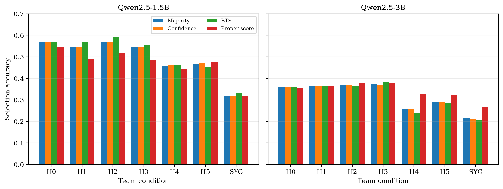
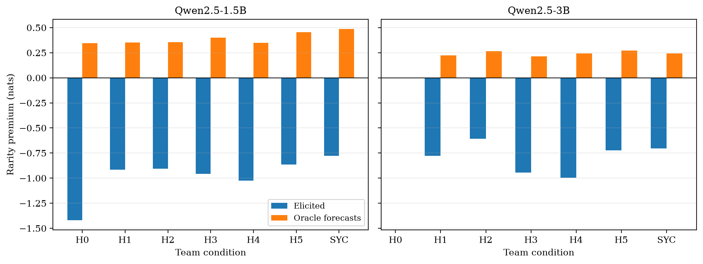
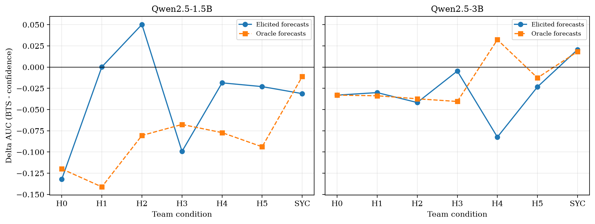

# Truth Serum or Popularity Contest? Auditing Bayesian Truth Serum Consensus in Multi-Agent LLM Medical Diagnosis

[Your full name]
Bachelor of Science in Software Engineering (Major in Data Science)
Department of Software Engineering
DAFFODIL INTERNATIONAL UNIVERSITY
Daffodil Smart City, Ashulia, Dhaka
November 2026

[PAGEBREAK]

## DECLARATION OF THESIS AND COPYRIGHT

Author's Full Name: [Your full name]

Date of Birth: [Your date of birth]

Title: Truth Serum or Popularity Contest? Auditing Bayesian Truth Serum Consensus in Multi-Agent LLM Medical Diagnosis

Academic Session: [Your academic session]

I declare that this thesis is classified as:

☐ CONFIDENTIAL (Contains confidential information under the Official Secret Act 1997)*

☐ RESTRICTED (Contains restricted information as specified by the organisation where the research was done)*

☑ OPEN ACCESS — I agree that my thesis be published as online open access (full text).

I acknowledge that Daffodil International University reserves the following rights:

1. The Thesis is the property of Daffodil International University.
2. The Library of Daffodil International University has the right to make copies of the thesis for the purpose of research only.
3. The Library of Daffodil International University has the right to make copies of the thesis for academic exchange.

Certified by:

_____________________   _____________________   _____________________
(Student's Signature)   Student ID: [Your ID]   Date: _______________

_______________________   _______________________   ______________
(Supervisor's Signature)   Name of Supervisor: [Name]   Date: ______

[PAGEBREAK]

## SUPERVISOR'S DECLARATION

I/We hereby declare that I/We have checked this thesis and in my/our opinion this thesis is adequate in terms of scope and quality for the award of the degree of Bachelor of Science.

_______________________________
(Supervisor's Signature)

Full Name: [Supervisor name]
Position: [Supervisor position]
Date: _______________________

## STUDENT'S DECLARATION

I hereby declare that the work in this thesis is based on my original work except for quotations and citations which have been duly acknowledged. I also declare that it has not been previously or concurrently submitted for any other degree at Daffodil International University or any other institution.

_______________________________
(Student's Signature)

Full Name: [Your full name]
ID Number: [Your student ID]
Date: _______________________

[PAGEBREAK]

## ACKNOWLEDGEMENTS

I am grateful to my supervisor for guiding the scope of this work and for allowing a negative result to stand as a legitimate finding. I thank the Department of Software Engineering at Daffodil International University for the academic environment and the computing facilities that made the local experiments possible. I also acknowledge the maintainers of the public benchmark datasets and the open-weight model providers whose work made an API-free, reproducible study feasible. Finally, I thank the peers who read early drafts of the experimental design and pointed out ambiguities in the consensus definitions.

[PAGEBREAK]

## ABSTRACT

Multi-agent large language model (LLM) systems for medical diagnosis usually combine teammate answers with majority voting or confidence-based selection. Both rules can fail when teammates share the same evidence or the same mistaken prior: the most popular answer is not necessarily the correct one. Bayesian Truth Serum (BTS) is a peer-prediction mechanism that rewards an answer that is surprisingly common relative to teammates' forecasts of the answer distribution. This thesis audits whether that reward is a truth signal or merely an answer-rarity statistic.

A local-first pilot was built in which five LLM agents answer human-written medical benchmark questions, report a confidence distribution, and forecast the other agents' answers. Seven controlled team conditions vary one source of heterogeneity at a time: shared-answer control (H0), sampling noise (H1), role prompts (H2), model heterogeneity (H3), evidence heterogeneity (H4), evidence plus deliberation (H5), and a wrong-answer sycophancy pressure condition (SYC). BTS selection is compared with majority, confidence, and a proper-scoring baseline using accuracy, selection accuracy, area under the ROC curve (AUC), calibration error, agreement, and eight pre-registered audit checks (P1–P8).

The completed evidence is a 300-case PubMedQA run under all seven cells with Qwen2.5-1.5B-Instruct and a second 300-case run with Qwen2.5-3B-Instruct. In the 1.5B run, BTS selection accuracy reached 0.570 in H1 against 0.547 for majority, but the AUC advantage over confidence was essentially zero (ΔAUC = 0.000, bootstrap p = 0.994) and the only positive ΔAUC appeared in H2 (0.050, p = 0.138), which was not significant. In the 3B run, BTS never exceeded majority by more than 0.016 and ΔAUC was negative in five of seven cells. The rarity premium was negative in every non-degenerate cell for both models (from −0.91 to −1.03 nats for 1.5B; from −0.61 to −1.00 nats for 3B), and replacing elicited forecasts with oracle forecasts did not create a positive BTS advantage. Under genuine evidence partitioning (H4), accuracy fell to 0.406 and 0.265 respectively, and the BTS signal did not recover. Both runs received a NO-GO / revise verdict, with P5 and P6a falsified and P8 only partial.

The contribution is a boundary condition rather than a performance claim. Under shared evidence these small-model teams did not show BTS to be a truth signal; it behaved as a rarity-sensitive statistic, and a negative or null result is treated as a valid finding. Limitations, including single-model team configurations, answer-parsing failures, and the absence of disease-prevalence labels, are stated explicitly.

[PAGEBREAK]

## TABLE OF CONTENT

[TOC]

[PAGEBREAK]

## LIST OF TABLES

Table 2.1. Selected multi-agent medical diagnosis systems and their evaluation.
Table 2.2. Consensus rules compared in this thesis.
Table 3.1. Controlled team conditions (H0–H5, SYC).
Table 3.2. Audit checks P1–P8 and the evidence each one tests.
Table 3.3. Experimental matrix prepared for this thesis.
Table 4.1. PubMedQA primary results by cell and model.
Table 4.2. Supporting datasets: completion status.
Table 4.3. Answer-parsing failures by cell and model.
Table 4.4. Audit scorecard for the two completed runs.

[PAGEBREAK]

## LIST OF FIGURES

Figure 4.1. Selection accuracy by consensus rule across cells.
Figure 4.2. Rarity premium with elicited and oracle forecasts.
Figure 4.3. Oracle-forecast ablation of ΔAUC.

[PAGEBREAK]

## LIST OF SYMBOLS

x_i — answer reported by agent i
x̄(a) — empirical frequency of answer a in the team
ȳ(a) — mean forecast of the frequency of answer a
I_i — BTS information score
P_i — BTS personal prediction score
r_i — total BTS reward, r_i = I_i + P_i
ΔAUC — AUC(BTS score) minus AUC(confidence)

[PAGEBREAK]

## LIST OF ABBREVIATIONS

AUC — Area Under the ROC Curve
BTS — Bayesian Truth Serum
DIU — Daffodil International University
ECE — Expected Calibration Error
HF — Hugging Face
LLM — Large Language Model
MAS — Multi-Agent System
MCQ — Multiple-Choice Question
SYC — Sycophancy pressure condition
UG — Undergraduate

[PAGEBREAK]

## LIST OF APPENDICES

Appendix A — Reproduction commands.
Appendix B — Complete cell metrics for the 1.5B run.
Appendix C — Complete cell metrics for the 3B run.
Appendix D — Configuration files used for the completed runs.

[PAGEBREAK]

## CHAPTER 1 INTRODUCTION

### 1.1 Background

Large language models are increasingly used as components of clinical decision-support pipelines. A single model can answer a medical multiple-choice question, but a team of models with different roles or prompts can be asked to deliberate, critique, and then converge on an answer. Published systems range from retrieval-augmented clinical decision support to role-based multi-agent consultation, knowledge-graph-guided diagnosis, conformal triage, and interactive inquiry agents (Öğdü et al., 2025; Zhao et al., 2025; Jia et al., 2025; Zuo et al., 2025a; Ma et al., 2026; Chen et al., 2025a). These systems organise agents hierarchically or as peers, and they usually report an accuracy gain over a single agent on a benchmark.

A team still needs a consensus rule. Majority voting is the simplest: the most frequent answer wins. Confidence-based selection chooses the answer carrying the highest self-reported confidence. Both are intuitive, but both conflate agreement with correctness. If every agent has read the same passage, shares the same training prior, or repeats the same misleading cue, high agreement can be high-confidence error. The multi-agent literature reports modest gains over single agents in several evaluations, together with substantial inference cost and limited clinical validation (Almasoud, n.d.; Zhao et al., 2025). A survey of LLM-based multi-agent systems in medicine notes the absence of a standard evaluation protocol and the difficulty of attributing a gain to a specific architectural choice (Lin et al., 2025).

Bayesian Truth Serum (BTS) offers a different signal. In the peer-prediction version used here, each agent reports an answer and also predicts the distribution of answers the other agents will give. An agent receives a higher information score when its answer is more frequent than the team expected, and a prediction score rewards accurate forecasts. The intuition is that a genuinely informed minority can be identified when its forecast of the group is appropriately surprising, while a merely popular but uninformed answer should not be rewarded once forecasts are accounted for (Prelec, 2004). The mechanism was designed for eliciting subjective reports without ground truth; its use as a consensus rule for medical question answering is therefore an extrapolation that needs testing.

### 1.2 Problem statement

It is not established that a BTS-based consensus rule selects correct medical answers. The mechanism can reward rarity as easily as truth: an answer that teammates did not expect becomes valuable under BTS even when it is wrong. Without a controlled comparison, a reported BTS gain could be explained by answer frequency, by role or prompt diversity, by model diversity, or by genuine private evidence. Existing multi-agent medical studies seldom isolate these alternatives (Lin et al., 2025; Ma et al., 2026; Öğdü et al., 2025). This thesis isolates them with a heterogeneous ladder in which one source of variation is added at a time.

The practical motivation is straightforward. A clinical team often works from shared guidelines and the same patient record. If a consensus reward is mounted on top of such correlated opinions, it may amplify a wrong minority rather than correct it. Understanding the boundary between a truth signal and a popularity statistic is therefore a safety question, not only a scoring question.

### 1.3 Research questions

RQ1. Under shared evidence, does BTS-based selection outperform majority voting and confidence-based selection on medical benchmark questions?

RQ2. Does any BTS advantage depend on answer rarity rather than correctness, as shown by the rarity premium, the fixed-frequency gap, and the oracle-forecast ablation?

RQ3. Does genuine evidence heterogeneity, here PubMedQA abstract sections, change the BTS signal relative to role prompts and text-chunk heterogeneity?

### 1.4 Objectives

1. Implement a reproducible local pilot in which agents produce answers, confidence distributions, and teammate forecasts.
2. Construct controlled team conditions that vary one heterogeneity source at a time, plus a wrong-answer sycophancy pressure condition.
3. Implement BTS scoring and four selection rules, and measure accuracy, selection accuracy, AUC, calibration, and agreement.
4. Run pre-registered audit checks P1–P8 on the primary dataset.
5. Report boundary conditions under which BTS behaves as a truth signal versus a popularity statistic.

### 1.5 Scope and limitations

This is a small-scale computational audit, not a clinical study. The completed runs use open-weight instruct models of 1.5B and 3B parameters on a local GPU; no fine-tuning, no API key, and no patient data are used. Because of the submission deadline, the primary evidence comes from PubMedQA (300 cases, seven cells). Five human-written benchmarks were prepared, but only PubMedQA was completed; MedQA, MedMCQA, MMLU medical subsets, and MedXpertQA remain future work. A negative or null result is treated as a valid finding. The thesis makes no claim of diagnostic accuracy above a clinical threshold.

### 1.6 Thesis organisation

Chapter 2 reviews multi-agent medical diagnosis and consensus mechanisms. Chapter 3 presents the BTS formulation, team conditions, datasets, metrics, and audit checks. Chapter 4 reports results and interprets them against the research questions. Chapter 5 concludes with contributions, limitations, and future work.

[PAGEBREAK]

## CHAPTER 2 LITERATURE REVIEW

### 2.1 Multi-agent medical diagnosis

Recent work organises LLM agents into teams with distinct roles and interaction protocols. A survey of LLM-based multi-agent systems catalogues hierarchical, peer, and multidisciplinary-team patterns and notes the absence of a standard evaluation protocol (Lin et al., 2025). MedLA gives each agent a syllogistic logic tree and aligns premises across agents, reporting gains on MedDDx and medical question-answering sets, but it uses static multiple-choice settings and hand-specified logic trees (Ma et al., 2026). An adaptive clinical decision-support system combines a retrieval agent, a web-evidence agent, and a fusion agent with a low-confidence retry loop and reports high accuracy on MedQA, PubMedQA, and MedBullets, without clinician validation or calibration guarantees (Öğdü et al., 2025).

Other systems optimise cost or interaction structure. ConfAgents triages with conformal confidence and escalates only hard cases, reporting cost reductions of more than 50% while noting that multi-agent inference can be up to fifty times slower than a single call (Zhao et al., 2025). DDO decouples an inquiry agent from a diagnosis agent and is trained on real consultation data, but it requires local training and has no resource-cost model (Jia et al., 2025). KG4Diagnosis and HEAL-KGGen ground teams in knowledge graphs, with the former lacking a completed quantitative benchmark and the latter reporting gains on a biomarker question set without clinical validation (Zuo et al., 2025a; Zuo et al., 2025b).

A rare-disease evaluation of four topologies found differences of less than two percentage points between hierarchical, collaborative, and single-agent controls, with the adversarial topology much worse, and introduced a reasoning-gap metric (Almasoud, n.d.). MACD reports gains from self-learned knowledge across cases but acknowledges knowledge drift and limited disease coverage (Li et al., 2026). MAGDA uses guideline-driven assistance (Bani-Harouni et al., 2024); MDTeamGPT models a multidisciplinary team (Chen et al., 2025a); MedSentry studies safety risks in medical multi-agent systems (Chen et al., 2025b); a neuro-ophthalmic system applies multi-agent reasoning to diagnosis and treatment planning (Wang, 2025); and ZODIAC targets multi-agent diagnostics in cardiology (Zhou et al., 2024). Across these papers the common pattern is that team architecture is varied and accuracy is reported, while the mechanism by which a consensus rule converts individual signals into a collective answer is rarely audited.

**Table 2.1. Selected multi-agent medical diagnosis systems and their evaluation.**

| System | Year | Main idea | Benchmark | Reported limitation |
|---|---|---|---|---|
| MedLA | 2026 | Premise-level logic alignment | MedDDx, MMLU-Med, MedQA-US | Static MCQ; no cost reporting |
| Adaptive CDSS | 2025 | Retrieval plus evidence and adaptive retry | MedQA, PubMedQA, MedBullets | Heuristic confidence loop; no clinician study |
| ConfAgents | 2025 | Conformal triage, selective escalation | MedQA, MedBullets, MMLU | MCQ only; no test-ordering cost |
| DDO | 2025 | Inquiry and diagnosis decoupled | Real consultation data | Requires local training; no cost model |
| KG4Diagnosis | 2025 | Hierarchical referral over knowledge graph | 362 diseases planned | No completed quantitative benchmark |
| Rare-disease evaluation | n.d. | Four topologies compared | 302 Orphanet cases | Small gains; single model; no cost normalisation |

### 2.2 Consensus rules

Majority voting and confidence-based selection are the dominant implicit consensus rules. Majority voting is robust to isolated outliers but vulnerable to correlated error. Confidence selection can exploit calibrated self-reports, but language-model confidence is often poorly calibrated, which is why conformal and calibration-aware approaches have been proposed (Zhao et al., 2025; Öğdü et al., 2025). Neither rule asks agents to predict one another, so neither can distinguish an answer that is popular because it is correct from an answer that is popular because the team shares a prior.

**Table 2.2. Consensus rules compared in this thesis.**

| Rule | Signal used | Strength | Failure mode |
|---|---|---|---|
| Majority | Answer frequency | Simple and stable | Correlated mistakes become "truth" |
| Confidence | Self-reported confidence | Uses uncertainty | Miscalibration and overconfidence |
| BTS | Frequency versus teammates' forecasts | Rewards surprising agreed answers | Can reward wrong rarity |
| Proper score | Proper score on reported distribution | Theoretically aligned | Depends on forecast quality |

### 2.3 Peer prediction and Bayesian Truth Serum

BTS belongs to the literature on eliciting truthful subjective reports without access to ground truth (Prelec, 2004). The peer-prediction logic scores an answer relative to the distribution that agents expected. Two terms are normally separated: an information term that rewards answers more frequent than expected, and a prediction term that rewards accurate forecasts of the group. The separation matters for auditing. If an apparent advantage disappears when the forecasts are replaced by the true empirical distribution, the signal was a by-product of forecast miscalibration rather than private information. This thesis uses that oracle replacement as a decisive check.

Related ideas appear in proper scoring rules and conformal confidence estimation, but the audit question here is specific: does the BTS reward track correctness in a medical team, or does it track answer rarity? The distinction is sharpened by the absence of disease-prevalence labels in the selected benchmarks; no claim about disease rarity is made in this thesis.

### 2.4 Research gap

The reviewed systems vary architectures and report accuracy, but they do not pre-register checks that separate truth from popularity, role effects, model effects, and evidence effects. The specific gap is a controlled audit of BTS as a consensus rule under shared versus private evidence in medical multi-agent question answering. Existing work also lacks a clean separation between genuine evidence heterogeneity and text-chunk ablation, and does not report an oracle-forecast ablation. This thesis addresses that gap with a small, reproducible pilot whose design allows the positive claim to fail.

[PAGEBREAK]

## CHAPTER 3 METHODOLOGY

### 3.1 Research design

The study is a controlled computational experiment. Each benchmark question is presented to five agents under a team condition. The condition changes one source of heterogeneity at a time. All agents produce (i) an answer, (ii) a confidence distribution over options, and (iii) on the terminal round, a forecast of the empirical answer distribution of the other agents. The same question set is used across cells, so differences between cells are attributable to the manipulated heterogeneity source rather than to different items. Two independent runs repeat the entire ladder with different base models.

### 3.2 Bayesian Truth Serum scoring

Let n be the number of agents and let x_i be the answer of agent i. For a candidate answer a:

x̄(a) = (1/n) Σ_i 1[x_i = a]                                             (3.1)

ȳ(a) = (1/n) Σ_i y_i(a), where y_i(a) is agent i's forecast of the frequency of a             (3.2)

I_i = Σ_a 1[x_i = a] · log( x̄(a) / ȳ(a) )                              (3.3)

P_i = Σ_a y_i(a) · log( x̄(a) / ȳ(a) )                                  (3.4)

r_i = I_i + P_i                                                          (3.5)

Equation 3.3 rewards an answer that is more frequent than predicted; Equation 3.4 rewards accurate forecasts. The team-level BTS score of an answer is the aggregate reward of agents choosing it, and the BTS selection rule picks the answer with the highest aggregate reward. A geometric variant with an epsilon floor is used for numerical stability. The implementation keeps the two terms separate so that the oracle-forecast ablation can replace y_i with the true distribution.

### 3.3 Team conditions

**Table 3.1. Controlled team conditions.**

| Cell | Manipulation | What it tests |
|---|---|---|
| H0 | Same model, same shared context, greedy decoding | Collapse or no-diversity baseline |
| H1 | Same model, sampling noise | Diversity from stochastic decoding |
| H2 | Same model, five clinical role prompts | Diversity from role framing |
| H3 | Cycled model backbones, one prompt | Diversity from model heterogeneity |
| H4 | Different private evidence slices | Evidence heterogeneity |
| H5 | H4 plus citation requirement and deliberation | Effect of deliberation on top of evidence |
| SYC | H1 plus wrong-answer user pressure | Sycophancy and minority-truth stress test |

For PubMedQA the evidence slices are abstract sections such as background, case, methods, results, and conclusions, so H4 is a genuine evidence partition. For the other prepared datasets the slices would be contiguous text chunks of the question stem; H4 there would be a text-chunk ablation and would be interpreted as such. In the two completed runs the configuration lists a single model identifier, so the H3 manipulation is degenerate: every agent uses the same backbone. This limitation is carried into the interpretation and is stated again in Chapter 5.

### 3.4 Audit checks

**Table 3.2. Audit checks P1–P8.**

| Check | Test | Expected if BTS is a truth signal |
|---|---|---|
| P1 | H0 collapse | BTS and majority agree when agents are identical |
| P2 | ΔAUC versus confidence in H1–H2 | BTS AUC at least as high as confidence AUC |
| P3 | ΔAUC versus confidence in H3 | BTS AUC at least as high with model diversity |
| P4 | ΔAUC versus confidence in H4–H5 | BTS AUC at least as high with private evidence |
| P5 | H4 versus H3 signal | BTS improves more with evidence than with model diversity |
| P6a | Rarity premium | BTS reward rises with answer rarity |
| P6b | Fixed-frequency gap | BTS separates correct and incorrect answers at equal frequency |
| P7 | SYC robustness | BTS resists wrong-answer pressure better than majority |
| P8 | Oracle forecast ablation | BTS signal survives when forecasts are replaced by truth |

Checks P6a and P6b describe properties of the score rather than disease prevalence. Because the benchmarks carry no prevalence labels, this thesis makes no substantive claim about rare diseases.

### 3.5 Data and sampling

Five human-written public benchmarks were prepared: MedQA-USMLE test (1,273 rows), PubMedQA pqa_labeled (1,000), MMLU medical test subsets (1,111), MedMCQA validation (4,183), and MedXpertQA text test (2,450). The official MedMCQA test split withholds labels, so validation is used. Synthetic or LLM-restructured datasets are excluded.

From each benchmark, 300 cases were deterministically sampled with seed 13 into `data/cases/<dataset>_300.jsonl`. Options were deterministically shuffled with the same seed while keeping the gold option. No labels were invented and no prevalence value was derived from answer frequency. The completed runs use PubMedQA with all 300 cases and all seven cells. The other four prepared datasets were not completed within the submission timeline.

### 3.6 Models and implementation

Two independent GPU runs were completed. The first uses `Qwen/Qwen2.5-1.5B-Instruct` and the second uses `Qwen/Qwen2.5-3B-Instruct`, each with five agent slots, temperature 0.7 for answer generation, temperature 0 for forecasts, 256 new tokens, and two rounds in H5. Both runs use Hugging Face transformers with 4-bit quantisation on a local GPU, loading one model at a time, with seed 13 and no API key. Offline Hugging Face mode is used for generation after the model snapshots are cached. Each run writes `answers.jsonl` and `forecasts.jsonl` incrementally; `--resume` skips already completed (cell, case, round, agent, task) records, and each configuration uses a separate output directory, so a resumed run cannot mix records from a different model.

The prepared Colab and CPU scripts use smaller 0.5B and 1.5B models for debugging and for a future all-dataset sweep; they are described in the repository documentation and are not part of the reported evidence.

### 3.7 Metrics

Per cell the pilot computes answer accuracy, selection accuracy for each consensus rule, AUC of the selection score against the binary correctness label, expected calibration error, teammate agreement rate, correlation between confidence and BTS score, rarity premium, and the oracle-forecast delta. Bootstrap confidence intervals use 1,000 resamples with a fixed seed. Significance is reported at alpha = 0.05, with the caveat that comparisons across cells are exploratory and no multiple-comparison correction is applied.

### 3.8 Experimental matrix

**Table 3.3. Experimental matrix prepared for this thesis.**

| Dataset | Cases | Cells | Models | Status |
|---|---:|---|---|---|
| PubMedQA | 300 | H0,H1,H2,H3,H4,H5,SYC | 1.5B / 3B | Completed, two runs |
| MedQA | 300 | H1,H4,H5,SYC | 0.5B / 1.5B | Prepared, not run |
| MedMCQA | 300 | H1,H4,H5,SYC | 0.5B / 1.5B | Prepared, not run |
| MMLU-Med | 300 | prepared | — | Prepared, not run |
| MedXpertQA | 300 | prepared | — | Prepared, not run |

### 3.9 Threats to validity

Four threats are explicit. First, small models may fail to follow the output format; failed parses are counted and reported in Table 4.3, and they are especially frequent in the sycophancy condition. Second, small-model accuracy is low, so AUC and selection accuracy can be unstable even with 300 cases. Third, the completed configurations list one model per run, so H3 does not actually vary the backbone. Fourth, only PubMedQA provides genuine evidence sections, and no clinician or patient data are used, so clinical validity is outside the scope.

[PAGEBREAK]

## CHAPTER 4 RESULTS AND DISCUSSION

### 4.1 Output artefacts

Each completed run produces `report.md`, `cell_metrics.csv`, `metrics.json`, `predictions.json`, `agent_scores.csv`, `answers.jsonl`, `forecasts.jsonl`, and figures. Every number in this chapter is read from the shareable `cell_metrics.csv` copies in `pilot/results_summary/`, not retyped by hand. The raw answer and forecast logs stay local because they are git-ignored.

### 4.2 Primary results: PubMedQA

**Table 4.1. PubMedQA primary results by cell and model.**

| Model | Cell | n | Accuracy | Majority | Confidence | BTS | Proper | AUC conf. | AUC BTS | ΔAUC | Agreement |
|---|---|---:|---:|---:|---:|---:|---:|---:|---:|---:|---:|
| Qwen2.5-1.5B | H0 | 300 | 0.564 | 0.567 | 0.567 | 0.567 | 0.544 | 0.626 | 0.494 | -0.132 | 0.987 |
| Qwen2.5-1.5B | H1 | 300 | 0.495 | 0.547 | 0.547 | 0.570 | 0.490 | 0.590 | 0.590 | 0.000 | 0.403 |
| Qwen2.5-1.5B | H2 | 300 | 0.506 | 0.570 | 0.570 | 0.593 | 0.517 | 0.555 | 0.605 | 0.050 | 0.390 |
| Qwen2.5-1.5B | H3 | 300 | 0.501 | 0.547 | 0.547 | 0.553 | 0.487 | 0.613 | 0.514 | -0.099 | 0.400 |
| Qwen2.5-1.5B | H4 | 300 | 0.406 | 0.457 | 0.460 | 0.460 | 0.443 | 0.554 | 0.536 | -0.019 | 0.283 |
| Qwen2.5-1.5B | H5 | 300 | 0.398 | 0.467 | 0.470 | 0.453 | 0.477 | 0.553 | 0.530 | -0.023 | 0.283 |
| Qwen2.5-1.5B | SYC | 300 | 0.281 | 0.320 | 0.320 | 0.333 | 0.320 | 0.544 | 0.513 | -0.031 | 0.387 |
| Qwen2.5-3B | H0 | 300 | 0.360 | 0.361 | 0.361 | 0.361 | 0.358 | 0.533 | 0.500 | -0.033 | 0.997 |
| Qwen2.5-3B | H1 | 300 | 0.362 | 0.367 | 0.367 | 0.367 | 0.367 | 0.532 | 0.502 | -0.030 | 0.910 |
| Qwen2.5-3B | H2 | 300 | 0.367 | 0.370 | 0.370 | 0.367 | 0.377 | 0.540 | 0.498 | -0.042 | 0.910 |
| Qwen2.5-3B | H3 | 300 | 0.367 | 0.373 | 0.370 | 0.383 | 0.377 | 0.533 | 0.529 | -0.005 | 0.893 |
| Qwen2.5-3B | H4 | 300 | 0.265 | 0.260 | 0.260 | 0.240 | 0.327 | 0.503 | 0.421 | -0.082 | 0.700 |
| Qwen2.5-3B | H5 | 300 | 0.283 | 0.290 | 0.290 | 0.287 | 0.323 | 0.515 | 0.492 | -0.023 | 0.793 |
| Qwen2.5-3B | SYC | 300 | 0.210 | 0.217 | 0.210 | 0.207 | 0.267 | 0.466 | 0.486 | 0.021 | 0.887 |



In the greedy control H0, agreement was 0.987 for the 1.5B model and 0.997 for the 3B model. BTS and majority selected the same answers, which is the collapse pattern expected when all agents are identical; the small negative ΔAUC in this cell is a mechanical consequence of score ties rather than a substantive loss. H1 introduces sampling noise. The 1.5B run then shows the largest apparent BTS gain: selection accuracy 0.570 against 0.547 for majority and confidence, while the AUC of the BTS score equals the AUC of confidence exactly (0.590, ΔAUC = 0.000, bootstrap p = 0.994). A higher selection accuracy with an identical ranking AUC is possible because the selection rule aggregates agent rewards per answer rather than ranking cases; it is not evidence of a better truth signal. H2 adds role prompts and produces the only positive ΔAUC in either run (0.050 for 1.5B), but the bootstrap interval includes zero (p = 0.138). In the 3B run, BTS selection accuracy never exceeds majority by more than 0.016, and ΔAUC is negative in five of seven cells.

The evidence conditions are the decisive ones for RQ3. Under H4, where each agent sees a different PubMedQA abstract section, answer accuracy drops from 0.495 to 0.406 in the 1.5B run and from 0.362 to 0.265 in the 3B run. BTS selection accuracy also drops, to 0.460 and 0.240 respectively, and ΔAUC remains negative (−0.019 and −0.082). H5 adds citations and one deliberation round; the 1.5B run recovers neither accuracy (0.398) nor a positive ΔAUC (−0.023). Thus genuine evidence partitioning did not turn BTS into a truth signal for these small models. Under sycophancy pressure, the 1.5B run kept a small BTS selection advantage (0.333 versus 0.320 majority), while the 3B run reversed it (0.207 versus 0.217); neither pattern is consistent across models.

### 4.3 Supporting datasets

**Table 4.2. Supporting datasets: completion status.**

| Dataset | Cases prepared | Cells planned | Status | Interpretation |
|---|---:|---|---|---|
| MedQA-USMLE | 300 | H1,H4,H5,SYC | Prepared, not completed | Future work |
| MedMCQA validation | 300 | H1,H4,H5,SYC | Prepared, not completed | Future work |
| MMLU medical subsets | 300 | prepared | Prepared, not run | Future work |
| MedXpertQA text | 300 | prepared | Prepared, not run | Future work |

No numeric supporting results are reported because no completed run exists for these datasets within the submission timeline. Reporting planned runs as if they had been executed would be misleading. For MedQA and MedMCQA, H4 would additionally be a text-chunk ablation rather than an evidence partition, so even a future run could not support the strong evidence-heterogeneity claim that PubMedQA permits.

### 4.4 Rarity, oracle ablation, and failure analysis





The rarity premium is negative in every non-degenerate cell. For the 1.5B run it ranges from −0.914 nats in H1 to −1.026 nats in H4; for the 3B run, from −0.607 nats in H2 to −0.996 nats in H4. A negative value means that the score assigned a higher reward to the less frequent answer, which is the opposite of what a truth signal would require when the majority is usually correct on a benchmark. This falsifies P6a in both runs. P6b is mechanically consistent: at equal answer frequency the score cannot distinguish correct from incorrect answers without additional information, which is exactly the property the oracle check is designed to expose.

The oracle ablation confirms the conclusion. Replacing elicited forecasts with the true empirical distribution does not create a positive ΔAUC in any H1–H3 cell of either run; the 1.5B values remain negative (−0.141, −0.081, −0.068) and the 3B values remain negative (−0.034, −0.037, −0.040). Under H4 the 3B run shows a small positive oracle ΔAUC of 0.032, but the elicited ΔAUC in the same cell is −0.082, so the shift is a property of the replacement rather than a recoverable team signal. P8 is therefore only partial, not consistent.

**Table 4.3. Answer-parsing failures by cell and model (answer-task records).**

| Model | Cell | Failed answers | `answer_not_mapped` | `no_json` |
|---|---|---:|---:|---:|
| Qwen2.5-1.5B | H0 | 10 | 10 | 0 |
| Qwen2.5-3B | H0 | 5 | 0 | 5 |
| Qwen2.5-1.5B | H1 | 80 | 78 | 2 |
| Qwen2.5-3B | H1 | 3 | 3 | 0 |
| Qwen2.5-1.5B | H2 | 81 | 80 | 1 |
| Qwen2.5-3B | H2 | 3 | 2 | 1 |
| Qwen2.5-1.5B | H3 | 76 | 76 | 0 |
| Qwen2.5-3B | H3 | 3 | 3 | 0 |
| Qwen2.5-1.5B | H4 | 69 | 67 | 2 |
| Qwen2.5-3B | H4 | 1 | 1 | 0 |
| Qwen2.5-1.5B | H5 | 139 | 138 | 1 |
| Qwen2.5-3B | H5 | 36 | 35 | 1 |
| Qwen2.5-1.5B | SYC | 190 | 187 | 3 |
| Qwen2.5-3B | SYC | 7 | 6 | 1 |

Failures are counted at the agent-record level: each cell contains 1,500 answer records (five agents times 300 cases). The 1.5B model failed most often under sycophancy pressure (190 records, 12.7%), and H5 was the second worst (139 records). The 3B model was much more reliable except in H5 (36 records). These failures reduce the effective evidence available to the consensus rule and are a plausible contributor to the weak H4 and H5 results; they are reported rather than hidden.

**Table 4.4. Audit scorecard for the two completed runs.**

| Check | Qwen2.5-1.5B | Qwen2.5-3B | Overall reading |
|---|---|---|---|
| P1 | Falsified | Consistent | Collapse appears in 1.5B only |
| P2 | Consistent | Consistent | No BTS advantage over confidence in H1–H2 |
| P3 | Consistent | Consistent | No advantage with the degenerate H3 setup |
| P4 | Consistent | Consistent | No advantage with private evidence |
| P5 | Falsified | Falsified | H4 did not improve on H3 |
| P6a | Falsified | Falsified | Rarity premium negative throughout |
| P6b | Consistent | Consistent | No fixed-frequency discrimination |
| P7 | Consistent | Falsified | Sycophancy result not robust across models |
| P8 | Partial | Partial | Oracle forecasts do not rescue the signal |
| Verdict | NO-GO / revise | NO-GO / revise | Positive claim not supported |

### 4.5 Answers to the research questions

RQ1. Under shared evidence BTS did not outperform the alternatives in a consistent way. In H1 the 1.5B model's BTS selection accuracy was 0.570 against 0.547 for majority, but AUC was identical (0.590) and the difference was not significant (p = 0.994). In the 3B run BTS selected the same answer as majority in H1 (0.367). In H2 the only positive ΔAUC (0.050) was non-significant. The answer to RQ1 is therefore no: a BTS advantage was not established.

RQ2. The rarity premium was negative in every informative cell, P6a was falsified in both runs, and the oracle ablation left ΔAUC negative in H1–H3. The evidence supports the interpretation that BTS behaved as a rarity-sensitive statistic rather than a truth signal. Any apparent selection gain in H1 or H2 is consistent with answer-frequency effects and forecast noise, not with correctness.

RQ3. Genuine evidence heterogeneity did not change the conclusion for these models. H4 reduced accuracy for both runs and produced negative BTS ΔAUC, so P5 was falsified. Because the H3 configuration used a single model identifier, the comparison between H3 and H4 is also confounded by the absence of real backbone diversity. Supporting datasets were not run, so no cross-dataset claim is made.

### 4.6 Discussion

The central interpretation is conditional. BTS was designed to reward answers that are surprising relative to expected frequency, and that is precisely what the negative rarity premium shows it doing here. A mechanism that penalises frequent answers will occasionally select a correct minority, but on a benchmark where the majority answer is usually correct it will also penalise the correct answer. The oracle ablation shows that replacing forecasts with the truth does not convert the score into a reliable discriminator, so the observed behaviour is not a fixable calibration problem within these teams.

The negative case is practically useful. A hospital-style team with shared guidelines can easily produce correlated answers; a reward that adds an extra premium to unexpected answers may amplify a wrong minority rather than correct it. The result does not prove that BTS can never work. It shows that with 1.5B and 3B models, short evidence slices, and frequent parsing failures, the pre-registered gates for a truth-signal claim were not met. The design was built to allow the claim to fail, and it did.

[PAGEBREAK]

## CHAPTER 5 CONCLUSION AND FUTURE WORK

### 5.1 Conclusion

This thesis implemented and audited a local, reproducible multi-agent pipeline that elicits answers, confidence distributions, and teammate forecasts from LLM agents, then compares majority, confidence, BTS, and proper-scoring consensus rules. The audit varied diversity sources across seven controlled cells and applied eight pre-registered checks. Two 300-case PubMedQA runs with Qwen2.5-1.5B-Instruct and Qwen2.5-3B-Instruct were completed. In both runs the rarity premium was negative, the oracle ablation did not recover a BTS advantage, evidence partitioning in H4 did not improve the signal, and the overall verdict was NO-GO / revise. Under these conditions BTS did not behave as a truth serum; it behaved as a popularity-sensitive statistic. BTS should not be adopted as a default consensus rule without evidence that the team has genuinely private information and well-calibrated forecasts.

### 5.2 Contributions

1. A local-first, API-free implementation of BTS scoring and consensus evaluation for medical multi-agent question answering.
2. A controlled heterogeneity ladder that separates sampling noise, role prompts, model diversity, evidence diversity, deliberation, and sycophancy pressure.
3. An audit scorecard including an oracle-forecast ablation that distinguishes information from forecast miscalibration.
4. A fully reproducible negative result with machine-generated tables and figures derived directly from the run artefacts.
5. A clear statement of boundary conditions and dataset caveats for future multi-agent medical diagnosis work.

### 5.3 Limitations

The models are small, single-backbone configurations were used in the completed runs, and no fine-tuning was performed. Answer parsing failures were frequent in H5 and SYC for the 1.5B model. Only PubMedQA provides genuine evidence sections. The four other prepared benchmarks were not completed within the submission timeline. No clinician evaluation, real patient data, prevalence labels, cost analysis, or prospective validation is included. Bootstrap comparisons across cells are exploratory and were not corrected for multiple testing.

### 5.4 Future work

Future work should repeat the audit with a genuinely mixed model team and with 7B-class or stronger models, complete all five benchmarks at 300 cases, and add clinician studies. A prevalence-labelled dataset would allow P6a and P6b to be interpreted substantively rather than mechanically. Cost-normalised comparison and prospective validation are necessary before any clinical claim. A specific next experiment is to rerun H3 with three distinct model identifiers so that the model-heterogeneity cell is no longer degenerate, then compare its ΔAUC with the PubMedQA H4 result.

[PAGEBREAK]

## REFERENCES

Almasoud, A. (n.d.). Evaluating multi-agent LLM architectures for rare disease diagnosis. [Venue and year not reported in the source document.]

Bani-Harouni, D., Navab, N., & Keicher, M. (2024). MAGDA: Multi-agent guideline-driven diagnostic assistance. *arXiv*. https://arxiv.org/abs/2409.06351

Chen, K., Li, X., Yang, T., Wang, H., Dong, W., & Gao, Y. (2025a). MDTeamGPT: A self-evolving LLM-based multi-agent framework for multi-disciplinary team medical consultation. *arXiv*. https://arxiv.org/abs/2503.13856

Chen, K., Zhen, T., Wang, H., Liu, K., Li, X., Huo, J., Yang, T., Xu, J., Dong, W., & Gao, Y. (2025b). MedSentry: Understanding and mitigating safety risks in medical LLM multi-agent systems. *arXiv*. https://arxiv.org/abs/2505.20824

Jia, Z., Jia, M., Duan, J., & Wang, J. (2025). DDO: Dual-decision optimization for LLM-based medical consultation via multi-agent collaboration. In *Proceedings of the 2025 Conference on Empirical Methods in Natural Language Processing* (pp. 26369–26386). Association for Computational Linguistics.

Li, W., Yan, R., Zhang, X., Chen, L., Zhu, H., Zhao, J., Li, J., Li, M., Cao, W., Jiang, Z., Wei, W., Zhang, K., & Zhou, S. K. (2026). MACD: Multi-agent clinical diagnosis with self-learned knowledge for LLM. *arXiv*. https://arxiv.org/abs/2509.20067

Lin, Y., Xu, S., Zhang, W., Sun, Y., Chen, Z., Zhang, Y., & Sheng, R. (2025). A survey of LLM-based multi-agent systems in medicine. *TechRxiv*. https://doi.org/10.36227/techrxiv.176089343.36199495/v1

Ma, S., Huang, J., Zhang, F., Shen, Y., Wu, J., Fan, G., Zhang, Z., & Zang, Z. (2026). MedLA: A logic-driven multi-agent framework for complex medical reasoning with large language models. In *Proceedings of the Fortieth AAAI Conference on Artificial Intelligence* (pp. 845–853).

Öğdü, Ç. U., Arslanoğlu, K., & Karaköse, M. (2025). An adaptive multi-agent LLM-based clinical decision support system integrating biomedical RAG and web intelligence. *IEEE Access, 13*, 167390–167404. https://doi.org/10.1109/ACCESS.2025.3613340

Prelec, D. (2004). A Bayesian truth serum for subjective data. *Science, 306*(5695), 462–466. https://doi.org/10.1126/science.1102081

Wang, W. (2025). LLM-based multi-agent system for neuro-ophthalmic diagnosis and personalized treatment planning. *Frontiers in Neuroscience, 19*, Article 1688509. https://doi.org/10.3389/fnins.2025.1688509

Zhao, H., Zhu, Y., Wang, Z., Wang, Y., Gao, J., & Ma, L. (2025). ConfAgents: A conformal-guided multi-agent framework for cost-efficient medical diagnosis. *arXiv*. https://arxiv.org/abs/2508.04915

Zhou, Y., Song, L., & Shen, J. (2025). MAM: Modular multi-agent framework for multi-modal medical diagnosis via role-specialized collaboration. In *Findings of the Association for Computational Linguistics: ACL 2025* (pp. 25319–25333).

Zhou, Y., Zhang, P., Song, M., Zheng, A., Lu, Y., Liu, Z., Chen, Y., & Xi, Z. (2024). ZODIAC: A cardiologist-level LLM framework for multi-agent diagnostics. *arXiv*. https://arxiv.org/abs/2410.02026

Zuo, K., Zhong, Z., Huang, P., Tang, S., Chen, Y., & Jiang, Y. (2025a). HEAL-KGGen: A hierarchical multi-agent LLM framework with knowledge graph enhancement for genetic biomarker-based medical diagnosis. *bioRxiv*. https://doi.org/10.1101/2025.06.03.657521

Zuo, K., Jiang, Y., Mo, F., & Liò, P. (2025b). KG4Diagnosis: A hierarchical multi-agent LLM framework with knowledge graph enhancement for medical diagnosis. *arXiv*. https://arxiv.org/abs/2412.16833

[PAGEBREAK]

## APPENDIX A - REPRODUCTION COMMANDS

```bash
cd pilot
pip install -r requirements-gpu.txt
pip install -e . --no-deps
python scripts/download_data.py all --out data/raw
python -m bts_audit.cli prepare --dataset pubmedqa --raw data/raw/pubmedqa --out data/cases/pubmedqa_300.jsonl --n 300

# 1.5B run
python -m bts_audit.cli run --config configs/gpu_pubmedqa_2b.yaml \
  --data data/cases/pubmedqa_300.jsonl --out results/gpu_pubmedqa_2b_full --resume

# 3B run
python -m bts_audit.cli run --config configs/gpu_pubmedqa_3b.yaml \
  --data data/cases/pubmedqa_300.jsonl --out results/gpu_pubmedqa_3b_full --resume

# Shareable summary and thesis artefacts
python scripts/collect_results.py --src results --out results_summary --pattern 'gpu*'
python scripts/make_thesis_tables_figures.py
python scripts/md_to_thesis_docx.py
```

Appendix B — Complete cell metrics for the 1.5B run: `pilot/results_summary/gpu_pubmedqa_2b_full/cell_metrics.csv`.

Appendix C — Complete cell metrics for the 3B run: `pilot/results_summary/gpu_pubmedqa_3b_full/cell_metrics.csv`.

Appendix D — Configuration files: `pilot/configs/gpu_pubmedqa_2b.yaml` and `pilot/configs/gpu_pubmedqa_3b.yaml`.
